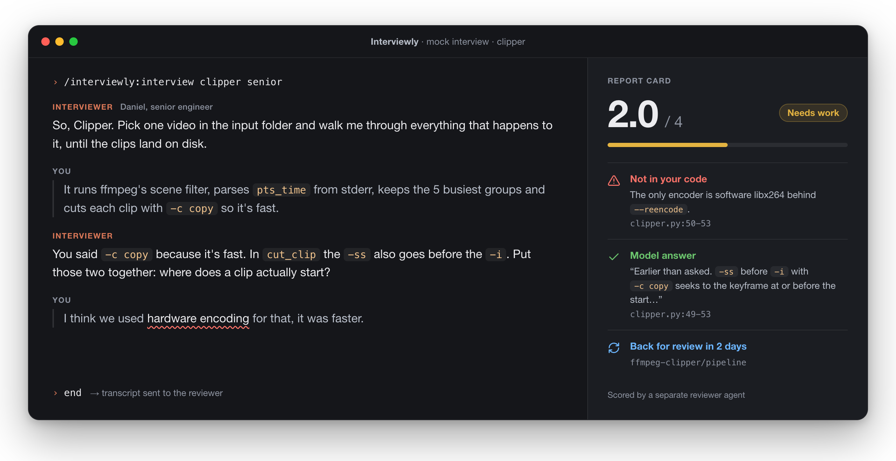
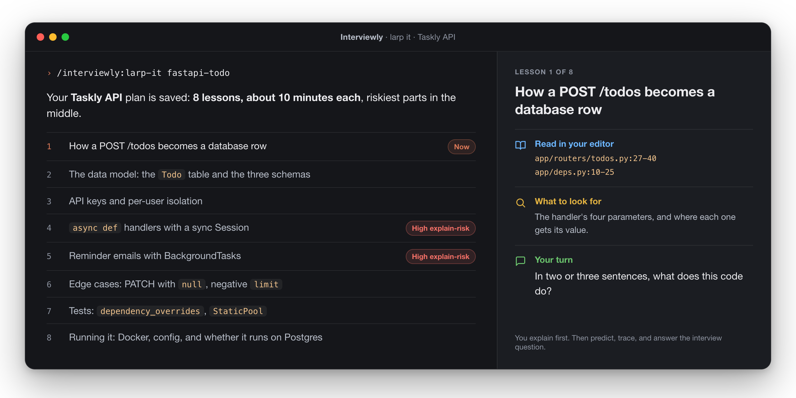

<h1 align="center">Interviewly</h1>

<p align="center">
  <strong>You built it. Now explain it.</strong>
</p>

<p align="center">
  Mock interviews about <em>your</em> code. Interviewly reads your CV and your projects, asks what a real interviewer would ask, follows up like one, and shows you the answer from your own files.
</p>

<p align="center">
  <a href="#get-started-in-a-minute"></a>
  <a href="#get-started-in-a-minute"></a>
  <a href="#get-started-in-a-minute"></a>
  <a href="https://github.com/Im-yusuf/interviewly/actions/workflows/ci.yml"></a>
  <a href="LICENSE"></a>
</p>

<p align="center">
  
</p>

<p align="center">
  <a href="#get-started-in-a-minute"><strong>Get started in a minute →</strong></a>
</p>

---

## Interviewers don't ask what you know. They ask what you did.

Nobody asks *"What is FastAPI?"* any more. They open your GitHub and ask:

> *"Your routes are `async`, but your database session isn't. What happens under load?"*
>
> *"Your CV says you cut latency by 60%. How did you measure that?"*
>
> *"Which part of this did **you** write?"*

A question bank can't get you ready for those, because they're about your project. Interviewly reads your project first.

**It's for you if you're:**

- 💼 **Job hunting** and want practice on your own projects, not generic questions
- ✨ **A vibe coder** who built something real with AI and now has to explain it
- 🎓 **A student, junior or career changer** whose CV is mostly side projects
- 😬 **Anyone** with a line on their CV they're not sure they could defend

## How it works

1. **Give it your CV and the job ad.** PDF, Word or Markdown. Paste the ad or a link, or skip it.
2. **Point it at your code.** Your GitHub, or folders on your machine. It studies each project the way an interviewer would the night before.
3. **Practise on what you actually built.** Your likely questions arrive in about a minute, and the answers get sharper once it has read your code. Mock interviews, drills and study guides are there whenever you want them.

## Vibe coded it? Larp it till you make it.

You shipped it with Claude, Cursor or Copilot. It works, it's on your CV, and you're proud of it. Then the interviewer asks why the cache sits *there*, and you realise you never really read that file.

**`/interviewly:larp-it`** turns your project into 10-minute lessons, riskiest code first. Read a little. Explain it back in your own words. Predict what breaks. Answer the question the interviewer will ask. Lesson by lesson, it becomes *your* code.

<p align="center">
  
</p>

- 🧭 **Find the parts you can't explain yet.** It reads your git history (AI co-author tags, files like `CLAUDE.md` or `.cursorrules`) and flags the code you'd struggle to explain. You confirm what's yours.
- ⏱️ **Ten minutes at a time.** One lesson a day is plenty, and each one comes back in your drills so it sticks.
- 🤝 **Own the AI question.** *"How did you use AI on this?"* is a standard question now. Have a true, confident answer ready: what you decided, what you rejected, what you caught.

**The name's a joke. The tool isn't.** It will never write you a script to bluff with. It teaches you the code until you don't need one.

## Everything it does

<table>
  <tr>
    <td width="50%" valign="top">
      <h3>🎙️ Mock interviews that dig</h3>
      <p>One question at a time, then <em>why?</em> and <em>what if?</em> It pushes back on buzzwords, vague numbers and "we", like a real interviewer. Stuck? Coach mode turns it into a lesson.</p>
    </td>
    <td width="50%" valign="top">
      <h3>📊 An honest report card</h3>
      <p>A separate reviewer scores every answer, calls out confident wrong ones, and gives you a model answer that quotes your own code.</p>
    </td>
  </tr>
  <tr>
    <td width="50%" valign="top">
      <h3>🎤 "Walk us through a project"</h3>
      <p>Practise the question nearly every interview starts with: timed, followed up, scored, then retried on the spot.</p>
    </td>
    <td width="50%" valign="top">
      <h3>🔍 A CV that survives follow-ups</h3>
      <p>Every claim checked against your code. Risky lines get safer wording, undersold strengths get added, and you get one clean PDF that applicant tracking systems read.</p>
    </td>
  </tr>
  <tr>
    <td width="50%" valign="top">
      <h3>🎯 Ready for a specific job</h3>
      <p>Paste the ad. See where you're strong, where you're thin, the questions you'll get, and what to study first.</p>
    </td>
    <td width="50%" valign="top">
      <h3>🔥 Five minutes a day</h3>
      <p>Quick drills bring weak topics back before you forget them, with a streak and a readiness score to keep you going.</p>
    </td>
  </tr>
</table>

You don't need to learn commands. Just ask: *"quiz me on my FastAPI project"*, *"what will they ask me about ffmpeg?"* or *"what should I practise next?"*

## See it catch a bluff

The repo comes with a sample CV that overclaims on purpose: Postgres when the code uses SQLite, "90% coverage" with two tests, hardware encoding that isn't there. After reading the code, Interviewly says:

```text
The biggest finding is that two of your CV bullets describe things the code doesn't do:
async database access in Taskly, and hardware-accelerated encoding in Clipper.
```

Then the mock interview goes straight for them, as in the screenshot at the top. Try it yourself in Claude Code (it keeps its data in a throwaway folder):

```bash
git clone https://github.com/Im-yusuf/interviewly && cd interviewly
INTERVIEWLY_HOME=/tmp/interviewly-demo claude --plugin-dir .
```

```
/interviewly:setup examples/sample-cv.md examples/fastapi-todo examples/ffmpeg-clipper
/interviewly:interview
```

## Get started in a minute

In **Claude Code**, type:

```
/plugin marketplace add Im-yusuf/interviewly
/plugin install interviewly@interviewly
/interviewly:start
```

Then paste a job ad, give it your CV, and pick **Likely questions** or **Practice now**.

<details>
<summary><strong>Using Codex or Antigravity?</strong></summary>

**Codex** (CLI or desktop app). In a terminal, then open Codex and onboarding starts by itself:

```bash
codex plugin marketplace add Im-yusuf/interviewly
codex plugin add interviewly@interviewly
```

Later, type `$interviewly:start` (Codex uses `$` where Claude Code uses `/`).

**Antigravity.** In a terminal, then restart Antigravity and type `/interviewly:start`:

```bash
git clone https://github.com/Im-yusuf/interviewly
./interviewly/install.sh antigravity
```

</details>

**You'll need** Python 3.8+ and git. For private GitHub repos, the GitHub CLI (`gh`) helps. Works on macOS and Linux; Windows should work but hasn't been tested.

## Honest by design

- **It never makes things up about you.** Every model answer and CV line comes from your code, your CV or what you told it. Suggested wording makes a claim easier to defend, never bigger.
- **It never touches your code.** It reads your projects. It doesn't edit, build or run them unless you say so.
- **Your data stays yours.** Interviewly has no server, no account and no tracking. Your CV and code are read by the AI app you already use, and everything Interviewly saves is plain files on your machine that one command deletes.
- **It doesn't nag.** At most one line a day, only when there's something worth practising, and you can turn it off.

Curious about the details? Read [how it works](docs/how-it-works.md) and [privacy and security](SECURITY.md).

## FAQ

**I can't share my work code. Does it still help?**
Yes. It prepares you from your CV instead, and interviews focus on what you did, how you measured it and what your part was.

**Which languages and frameworks?**
Any. It reads whatever is in your repo, from React and FastAPI to Kubernetes, PyTorch and ffmpeg.

**Which apps does it work in?**
Claude Code, Codex (CLI and desktop app) and Antigravity. claude.ai and the Codex IDE extension can't read local code, so they aren't supported.

**How do I update or remove it?**
See [updating and removing](docs/how-it-works.md#updating-and-removing). Your data stays until you delete it.

<details>
<summary><strong>All commands</strong></summary>

| Command | What it does |
|---|---|
| `/interviewly:start` | Start here: job ad, CV, then likely questions or practice |
| `/interviewly:interview` | Mock interview with a scored report card |
| `/interviewly:larp-it <project> [file]` | Learn code you can't explain yet, in 10-minute lessons |
| `/interviewly:walkthrough [project]` | Practise walking through a project, timed and followed up |
| `/interviewly:breakdown <project>` | A written study guide to one project |
| `/interviewly:prep <technology>` | Common questions for one technology, tied to how you used it |
| `/interviewly:drill` | Five-minute drill: reviews you owe plus a few new topics |
| `/interviewly:audit` | Check every CV claim against your code |
| `/interviewly:cv` | An honest CV rewrite for a job, as an ATS-ready PDF |
| `/interviewly:target <job ad>` | Fit, likely questions and company research for one role |
| `/interviewly:stories` | True STAR stories, including "how I used AI" |
| `/interviewly:debrief` | After a real interview: better answers and the next round |
| `/interviewly:progress` | Readiness, streak and what to do next |
| `/interviewly:setup` | Add a project, update your CV, turn the reminder on or off |

**Interview styles:** project deep-dive · tech fundamentals · behavioral · system design · CV claims · mixed.
**Interviewers:** senior engineer · sceptical bar-raiser · hiring manager · friendly recruiter · system design.
**During an interview:** `hint` · `skip` · `feedback` · `pause` · `settings` · `end`.

</details>

## Contributing

Ideas, bug reports and pull requests are welcome. [CONTRIBUTING.md](CONTRIBUTING.md) explains how the project is put together, and the [changelog](CHANGELOG.md) shows what's new.

## License

[MIT](LICENSE)

<p align="center">
  <br>
  If Interviewly helps you land the job, a ⭐ helps the next person find it.
</p>
