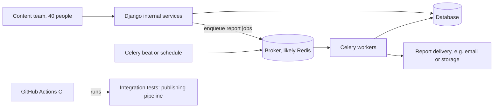

# Brightline Media (Junior Backend Developer)

## Summary
Current job (Sep 2024 – present, about 2 years) as a junior backend developer at a media company. Built from the CV alone: the user has no access to this code. The CV describes maintaining internal Django services for a 40-person content team, leading a reporting-service migration from cron to Celery, and adding integration tests and GitHub Actions CI to a publishing pipeline. Because nothing here can be checked against code, every claim has to stand on the user's own explanation, so the interview will probe for concrete detail.

## Stack
| Technology | Used for | Evidence |
|---|---|---|
| Python / Django | Internal services for the content team | CV bullet 1 (no code available) |
| Celery | Reporting service (replaced cron scripts) | CV bullet 2 (no code available) |
| Message broker (likely Redis, since Redis is on the CV; unconfirmed) | Celery broker / result backend | Inferred: Celery needs a broker (no code available) |
| cron | The old reporting setup | CV bullet 2 |
| GitHub Actions | CI for the publishing pipeline | CV bullet 3 (no code available) |
| pytest or Django test runner (unconfirmed) | Integration tests for the publishing pipeline | CV bullet 3 (no code available) |

## Architecture
(no code available)

Likely shape, inferred from the CV only. Confirm or correct it before an interview:

The user should be able to draw the real version of this: what the Django services do, where reports come from and go to, what triggers a report, and what the broker is.

## Components
### Django internal services
- **What:** internal tools for a 40-person content team
- **How:** (no code available). Be ready to describe one service end to end: models, views/APIs, who uses it.
- **Files:** (no code available)
- **Notable:** "maintained" implies bug fixing and on-call-style work; expect "tell me about a bug you fixed" questions.

### Reporting service (cron → Celery)
- **What:** generates reports that used to take about 6 hours to arrive and now take about 20 minutes
- **How:** (no code available). Likely moved from sequential cron scripts to tasks queued on Celery and run by workers in parallel, possibly triggered by Celery beat or by events.
- **Files:** (no code available)
- **Notable:** the speed-up is almost certainly from parallelism and/or removing the wait between cron runs, not from Celery itself. Know which.

### Publishing pipeline tests and CI
- **What:** integration tests for the publishing pipeline, run in GitHub Actions
- **How:** (no code available). Be ready to say what the tests exercise, what they mock, and how the DB and external services are handled in CI.
- **Files:** (no code available)
- **Notable:** "set up" CI means you should know the workflow file: triggers, jobs, caching, what blocks a merge.

## Key flows
(no code available)

1. Report generation: what triggers it, how work is split into tasks, where the output goes, how failures are retried.
2. A publishing-pipeline integration test: setup, what it calls, what it asserts, teardown.

## Decisions and trade-offs
| Decision | Evidence | Likely reason | Alternatives | Trade-off |
|---|---|---|---|---|
| Replace cron scripts with Celery | CV bullet 2 | Parallelism, retries, visibility, no fixed schedule gaps | Faster cron scripts, RQ/Dramatiq, a managed queue (SQS), Airflow | More moving parts (broker, workers, monitoring); duplicate execution risk with at-least-once delivery |
| Integration tests over unit tests for the pipeline | CV bullet 3 | Pipeline bugs live in the joins between steps | Unit tests with mocks, end-to-end tests | Slower and needs real services (DB/broker) in CI |
| GitHub Actions for CI | CV bullet 3 | Code already on GitHub | GitLab CI, Jenkins, CircleCI | (no code available) |

## Non-obvious details
(no code available). Before an interview, write down from memory: the broker and result backend, the number of Celery workers and concurrency, any task time limits, the retry policy, how report tasks are made idempotent, and how long the CI run takes.

## Weak spots
- **"Led" as a junior:** an interviewer will ask who else was involved, what you decided vs what a senior decided, and how you got buy-in. Have a clear, honest answer.
- **6 hours → 20 minutes:** you need to explain where the time went before and after, and how you measured it.
- **Celery failure modes:** worker crashes, duplicate tasks, retries, poison tasks, monitoring (Flower?), and what happens if the broker goes down.
- **No code to show:** everything rests on your explanation, so vagueness reads as exaggeration.

## Probe points
- `[what]` What do the Django services you maintain actually do, and who uses them day to day? · topic: `brightline-media/django-services-overview` · answer in: (your own experience) · key idea: name one service, its main models and its users concretely.
- `[how]` Walk me through a bug you fixed in one of the Django services, from report to deploy. · topic: `brightline-media/django-bug-story` · answer in: (your own experience) · key idea: a specific bug, how you found it, the fix, and how you stopped it recurring.
- `[what]` What did the old cron-based reporting setup look like, and why did it take 6 hours? · topic: `brightline-media/cron-reporting-bottleneck` · answer in: (your own experience) · key idea: name the bottleneck (sequential work, schedule gaps, slow queries) precisely.
- `[how]` How is a report generated now? What triggers it, how is the work split into Celery tasks, and where does the output go? · topic: `brightline-media/celery-report-flow` · answer in: (your own experience) · key idea: trigger → tasks (chord/group?) → workers → delivery.
- `[how]` What broker and result backend do you use, and why? · topic: `brightline-media/celery-broker-choice` · answer in: (your own experience) · key idea: Redis vs RabbitMQ trade-offs; durability vs simplicity.
- `[why]` Where exactly did the time go from 6 hours to 20 minutes? How did you measure it? · topic: `brightline-media/report-speedup-measurement` · answer in: (your own experience) · key idea: before/after timing method; parallelism vs removing waits.
- `[what]` What did "led" mean here: who else worked on it, and which decisions were yours? · topic: `brightline-media/led-migration-scope` · answer in: (your own experience) · key idea: honest scope; your decisions, your influence, who reviewed.
- `[how]` What do your integration tests for the publishing pipeline cover, and what do they mock? · topic: `brightline-media/publishing-integration-tests` · answer in: (your own experience) · key idea: real DB vs mocks; what boundary each test crosses.
- `[how]` Walk me through the GitHub Actions workflow you set up. What runs on each push, and what blocks a merge? · topic: `brightline-media/github-actions-ci` · answer in: (your own experience) · key idea: triggers, jobs, services (Postgres/Redis containers), caching, required checks.
- `[what-if]` A Celery worker dies halfway through a report task. What happens? · topic: `brightline-media/celery-worker-crash` · answer in: (your own experience) · key idea: acks_late, visibility timeout, retries, idempotent tasks.
- `[what-if]` The same report task runs twice. Would anyone notice, and how did you make tasks idempotent? · topic: `brightline-media/celery-idempotency` · answer in: (your own experience) · key idea: at-least-once delivery; dedupe keys or upserts.
- `[change]` If report volume grew 10x, what would break first and what would you change? · topic: `brightline-media/reporting-scale-10x` · answer in: (your own experience) · key idea: DB load, worker concurrency, queue routing, back-pressure.

## CV claims vs code
| CV bullet | Evidence | What the code shows |
|---|---|---|
| Maintained internal Django services used by the 40-person content team | none | No code available (company code). Rests on the user's account. |
| Led the migration of the reporting service from cron scripts to Celery, cutting report delivery time from 6 hours to 20 minutes | none | No code available. Both the leadership and the metric need the user's own account. |
| Wrote integration tests for the publishing pipeline and set up GitHub Actions CI | none | No code available. Rests on the user's account. |

## Numbers
From the CV only: 40-person content team; report delivery 6 hours → 20 minutes (about 18x faster); role started Sep 2024 (about 2 years).
