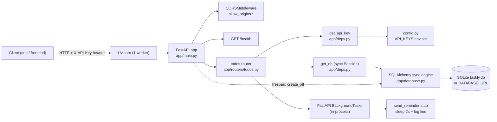

# Taskly API

## Summary
Taskly is a small FastAPI CRUD service for todos. Each todo belongs to the API key that created it, and creating one with a due date and an email queues a stubbed "email reminder" through FastAPI `BackgroundTasks`. The project is tiny: 12 Python files (3 of them empty `__init__.py`), 227 lines of Python, 5 routes, 2 tests, a 6-line Dockerfile, no CI and no compose file. There is no `.git` directory, so commit count, active months and authorship can't be established. The code reads as one person's learning or portfolio project. The candidate probably wrote all of it, but that can't be verified. Several CV claims (PostgreSQL, async database access, background workers, 90% coverage) go well beyond what the code shows.

## Stack
| Technology | Used for | Evidence |
|---|---|---|
| Python 3.12 | Runtime (container base image) | `Dockerfile:1` |
| FastAPI 0.115.0 | HTTP routing, dependency injection, `BackgroundTasks`, lifespan | `requirements.txt:1`, `app/main.py:19`, `app/routers/todos.py:10` |
| Uvicorn 0.30.6 | ASGI server, single process | `requirements.txt:2`, `Dockerfile:6` |
| SQLAlchemy 2.0.35 | ORM using the 2.0 typed style (`DeclarativeBase`, `Mapped`, `select()`), **sync** engine and session | `requirements.txt:3`, `app/database.py:6-11`, `app/models.py:9-18` |
| Pydantic 2.9.2 | Request and response schemas, `model_dump(exclude_unset=True)` | `requirements.txt:4`, `app/schemas.py:6-25` |
| SQLite | Default database (file `taskly.db`); in-memory database for tests | `app/config.py:3`, `tests/test_todos.py:14` |
| pytest 8.3.3 + httpx 0.27.2 | Tests through FastAPI `TestClient` | `requirements.txt:5-6`, `tests/test_todos.py:5,28` |
| Docker | Single-stage container image | `Dockerfile:1-6` |

Not present anywhere in the repo, despite being on the CV: PostgreSQL driver (psycopg/asyncpg), async SQLAlchemy, Redis, Celery, SMTP or email library, `email-validator`, pytest-cov, Alembic, docker-compose, CI config.

## Architecture

The only entry point is `app.main:app`. It's started by `uvicorn` (`Dockerfile:6`, `README.md:7`). On startup, `lifespan` runs `Base.metadata.create_all` (`app/main.py:13-16`). There is no migration tool. Everything goes through one router, `/todos` (`app/routers/todos.py:10`), whose handlers depend on two FastAPI dependencies: `get_db` yields a sync SQLAlchemy `Session`, and `get_api_key` checks the `X-API-Key` header against a set parsed from env (`app/deps.py:10-25`). The layers are thin: router, ORM model, database. There is no service or repository layer, except `services/notifications.py`, which only holds the reminder stub. The one data store is whatever `DATABASE_URL` points at, SQLite by default. There are no external services: the "email" is a `time.sleep(2)` followed by a log line (`app/services/notifications.py:12-13`).

## Components
### App bootstrap
- **What:** Creates the FastAPI app, wires up middleware and the router, creates tables on startup.
- **How:** An `asynccontextmanager` lifespan calls `create_all(engine)` before the app yields. CORS allows every origin, method and header. A `/health` route returns a static `{"status": "ok"}`.
- **Files:** `app/main.py:10`, `app/main.py:13-16`, `app/main.py:19-21`, `app/main.py:24-26`
- **Notable:** `/health` never touches the database, so it reports healthy even when the database is down. `logging.basicConfig` runs at import time (`app/main.py:10`).

### Config
- **What:** Reads env vars once, at import time.
- **How:** `DATABASE_URL` defaults to `sqlite:///./taskly.db`. `API_KEYS` is a comma-separated env var, stripped and turned into a `set`. `REMINDER_FROM` sets the sender address.
- **Files:** `app/config.py:3-5`
- **Notable:** Because the keys are read at import, changing keys needs a restart. It's also why the test sets `os.environ["API_KEYS"]` *before* importing the app (`tests/test_todos.py:3`). If `API_KEYS` is empty, every request gets a 401.

### Persistence (engine, session, model)
- **What:** Sync SQLAlchemy engine and session factory, plus a single `Todo` table.
- **How:** `create_engine(DATABASE_URL, connect_args={"check_same_thread": False})` and `sessionmaker(autoflush=False)`. `Todo` has `id`, `owner_key` (indexed, `String(64)`), `title` (`String(200)`, NOT NULL), `done` (NOT NULL, default False), `due_at` (nullable `DateTime`), `remind_email` (`String(254)`) and `created_at` (`server_default=func.now()`).
- **Files:** `app/database.py:6-11`, `app/models.py:9-18`
- **Notable:** `check_same_thread` is a SQLite-only argument. With a Postgres URL, psycopg2 would likely reject it as an invalid connection option, so the code can't run on Postgres as written. Nullability comes from the `Mapped[...]` annotations: `Mapped[str]` and `Mapped[bool]` mean NOT NULL. `DateTime` doesn't set `timezone=True`.

### Dependencies and API-key auth
- **What:** Per-request session and API-key check.
- **How:** `get_db` is a **sync** generator dependency (`yield db`, then `close()` in `finally`). `get_api_key(x_api_key: str = Header(...))` returns 401 if the key isn't in `API_KEYS`, and otherwise returns the key. That key then becomes the tenant id.
- **Files:** `app/deps.py:10-15`, `app/deps.py:18-21`, `app/deps.py:24-25`
- **Notable:** FastAPI turns the `x_api_key` parameter into an `x-api-key` header. Because the header is declared `Header(...)` (required), a request with **no** header gets a **422** validation error, not a 401. Only a wrong key gets 401. `DbSession`/`ApiKey` are module-level `Depends()` objects used as defaults, which is the pre-`Annotated` style.

### Schemas
- **What:** Pydantic input and output models.
- **How:** `TodoCreate` (title 1–200 characters, optional `due_at` and `remind_email`), `TodoUpdate` (every field optional, applied with `exclude_unset`), `TodoOut` (`from_attributes=True`; it leaves out `owner_key` and `remind_email`).
- **Files:** `app/schemas.py:6-25`
- **Notable:** `EmailStr` is imported but never used (`app/schemas.py:3`). `remind_email` is a plain `str` (`app/schemas.py:9`). That's likely because `email-validator`, which `EmailStr` needs, isn't in `requirements.txt`. `TodoUpdate` can't change `remind_email`.

### Todos router
- **What:** The four CRUD endpoints, all scoped to the caller's key.
- **How:** List filters on `owner_key == key`, optionally on `done`, orders by `created_at desc` and pages with `limit`/`offset`. Create inserts, commits, refreshes, then queues a reminder if both `due_at` and `remind_email` are set. Patch and delete go through `_get_owned`, which returns 404 when the todo doesn't exist *or* belongs to another key.
- **Files:** `app/routers/todos.py:13-24`, `app/routers/todos.py:27-40`, `app/routers/todos.py:43-47`, `app/routers/todos.py:50-57`, `app/routers/todos.py:60-64`
- **Notable:** Every handler is `async def` but makes blocking sync `Session` calls (`db.scalars`, `db.commit`, `db.refresh`, `db.get`), so database I/O runs on the event-loop thread. `limit` is `Query(20, le=100)` with no `ge` (`app/routers/todos.py:16`), and `offset` has no bounds at all (`app/routers/todos.py:17`).

### Notifications service
- **What:** The "email reminder".
- **How:** A sync function that sleeps 2 s ("simulates a slow SMTP server") and then logs the sender, recipient, title and due date.
- **Files:** `app/services/notifications.py:10-13`
- **Notable:** Because it's a plain `def`, Starlette runs it in the anyio threadpool, so the sleep doesn't block the event loop. It runs right after the create response is sent, **not** at `due_at`. The recipient's email address ends up in the logs (PII).

### Tests
- **What:** Two tests using `TestClient`.
- **How:** An in-memory SQLite engine with `StaticPool` (`tests/test_todos.py:14`), tables created by hand (`tests/test_todos.py:16`), `get_db` swapped out with `app.dependency_overrides` (`tests/test_todos.py:27`). `test_create_and_list` and `test_rejects_bad_key` are the only tests.
- **Files:** `tests/test_todos.py:1-40`
- **Notable:** `TestClient(app)` isn't used as a context manager (`tests/test_todos.py:28`), so the lifespan `create_all` against the real `taskly.db` never runs in tests. The database is shared at module level and never reset, and `test_create_and_list` asserts an exact list (`tests/test_todos.py:36`), so it would break if another test added todos with the same key first.

### Container
- **What:** Single-stage Docker image.
- **How:** `python:3.12-slim`, `COPY . .`, then `pip install`, `EXPOSE 8000`, `uvicorn` on 0.0.0.0:8000.
- **Files:** `Dockerfile:1-6`
- **Notable:** Copying the source before `pip install` invalidates the dependency layer cache on every code change. There's no `.dockerignore`, so a local `taskly.db` or venv would get copied in. The container runs as root, pytest and httpx ship in the runtime image, and there's one Uvicorn worker and no `HEALTHCHECK`.

## Key flows
**1. POST /todos with a reminder**
1. Uvicorn passes the request to the app, and CORS middleware adds headers (`app/main.py:20`).
2. FastAPI validates the body against `TodoCreate`: title 1–200 characters, `due_at` parsed into a `datetime`, `remind_email` taken as a raw string (`app/schemas.py:6-9`).
3. The dependencies resolve. `get_db` (sync, so it runs in the threadpool) opens a `SessionLocal()` (`app/deps.py:10-13`). `get_api_key` checks the header against the set (`app/deps.py:18-21`).
4. The handler builds `Todo(owner_key=key, **body.model_dump())`, then `add`, `commit` and `refresh`. The refresh loads the server-generated `created_at` (`app/routers/todos.py:34-37`, `app/models.py:18`). These calls block the event loop.
5. If both `due_at` and `remind_email` are set, it calls `background.add_task(send_reminder, email, title, due_at)` with primitive values, not the ORM object (`app/routers/todos.py:38-39`).
6. FastAPI serialises the result as `TodoOut` with a 201 (`app/routers/todos.py:27`, `app/schemas.py:18-25`). The `get_db` teardown closes the session.
7. After the response is sent, `send_reminder` runs in the threadpool: it sleeps 2 s and logs (`app/services/notifications.py:12-13`). No email is sent.

**2. GET /todos?done=false&limit=20&offset=0**
1. Auth and session as in flow 1 (`app/deps.py:10-21`).
2. FastAPI validates the query params: `done` is a tri-state optional bool, `limit` is at most 100 (`app/routers/todos.py:15-17`).
3. It builds `select(Todo).where(owner_key == key).order_by(created_at.desc())` and adds the `done` filter if one was given (`app/routers/todos.py:21-23`).
4. It runs `db.scalars(stmt.limit(limit).offset(offset)).all()` synchronously and returns the result as `list[TodoOut]` (`app/routers/todos.py:24`, `app/routers/todos.py:13`).

**3. PATCH /todos/{id}**
1. Auth and session as above.
2. `_get_owned` does `db.get(Todo, id)` and raises 404 if the todo is missing or `owner_key != key` (`app/routers/todos.py:43-47`).
3. For each field the client actually sent (`model_dump(exclude_unset=True)`), it calls `setattr` on the todo, then commits and refreshes (`app/routers/todos.py:53-56`).
4. It returns `TodoOut`. Changing `due_at` here does **not** queue or reschedule a reminder (`app/routers/todos.py:50-57`).

## Decisions and trade-offs
| Decision | Evidence | Likely reason | Alternatives | Trade-off |
|---|---|---|---|---|
| API keys come from a comma-separated env var held in an in-memory set | `app/config.py:4`, `app/deps.py:18-21` | Simplest auth with no users table | Hashed keys in a DB table, OAuth2/JWT, an API gateway | Rotating or revoking a key needs a redeploy. No per-key metadata, scopes or rate limits. |
| The raw API key is the tenant id (`owner_key`) | `app/models.py:13`, `app/routers/todos.py:21,34` | Avoids a users table | `user_id` foreign key, with keys mapping to users | Rotating a key orphans that key's todos. A database leak exposes valid keys in plaintext. |
| Return 404, not 403, for another owner's todo | `app/routers/todos.py:45-46` | Don't reveal that other tenants' ids exist | 403 Forbidden | Clients can't tell "doesn't exist" from "not yours" (deliberately). |
| `async def` handlers with a sync `Session` | `app/routers/todos.py:14,28,51,61`, `app/database.py:6` | Likely assumed that `async def` means faster | Plain `def` handlers (threadpool), or `create_async_engine` with `AsyncSession` and asyncpg | Database calls block the event loop and serialise concurrent requests. This is the opposite of the CV's latency claim. |
| `BackgroundTasks` for reminders | `app/routers/todos.py:30,39` | No extra infrastructure | Celery or RQ with Redis, arq, APScheduler, a cron scanner on `due_at` | Runs in-process: lost on restart or crash, no retries, no scheduling at due time, and it competes for the request threadpool. |
| `create_all` on startup, no migrations | `app/main.py:15` | Fast to get going | Alembic | New columns never reach existing databases, and there's no schema history. |
| SQLite as the default database | `app/config.py:3`, `app/database.py:6` | Zero-setup local development | Postgres in docker-compose | Table-level write locking. The SQLite-only `connect_args` ties the code to SQLite. |
| Offset pagination ordered by `created_at` | `app/routers/todos.py:16-24` | Simple | Keyset or cursor pagination on `(created_at, id)` | Order is unstable when timestamps tie (one-second resolution in SQLite), and large offsets are slow. The index is on `owner_key` only, not `(owner_key, created_at)`. |
| Pass primitive values to the background task | `app/routers/todos.py:39` | Likely to avoid using the ORM object after `get_db` closes the session. In FastAPI 0.115, yield-dependency teardown runs before background tasks (likely). | Pass the id and open a fresh session inside the task | Simple and safe, but sends a snapshot, not the latest state. |
| Output schema hides `owner_key` and `remind_email` | `app/schemas.py:18-25` | Don't echo the API key or PII | Return everything | Clients can't read back the reminder address they set. |
| Partial update with `exclude_unset=True` | `app/routers/todos.py:53` | PATCH semantics: only touch fields that were sent | PUT with a full replacement | Explicit `null` values go straight through to NOT NULL columns (see Weak spots). |

## Non-obvious details
- The test sets `os.environ["API_KEYS"] = "test-key"` on line 3, before any app import, because `config.py` reads the env at import time (`tests/test_todos.py:3`, `app/config.py:4`).
- `StaticPool` with `sqlite://` (`tests/test_todos.py:14`): every new connection to an in-memory SQLite database gets an empty database, so the pool has to reuse one connection or the tables made at line 16 would disappear.
- `TestClient(app)` without `with` (`tests/test_todos.py:28`) means the lifespan never runs in tests, so they never create `taskly.db` on disk.
- A missing `X-API-Key` returns 422, a wrong one returns 401 (`app/deps.py:18-20`).
- Why `check_same_thread=False` is needed (`app/database.py:6`): the sync `get_db` dependency runs in a threadpool worker, but the `async def` handler uses the session on the event-loop thread, so the SQLite connection crosses threads.
- `db.refresh(todo)` after commit loads `created_at`, which the database's `server_default` sets, not Python (`app/routers/todos.py:37`, `app/models.py:18`).
- `EmailStr` is imported but unused, and `remind_email` is a plain `str` (`app/schemas.py:3,9`). `email-validator` is missing from `requirements.txt`.
- `send_reminder` is deliberately sync, so Starlette runs it in the threadpool and `time.sleep(2)` doesn't freeze the loop (`app/services/notifications.py:10-12`).
- The "reminder" fires straight after creation, not at `due_at` (`app/routers/todos.py:38-39`).
- `DELETE` returns an explicit `Response(status_code=204)` instead of `None` (`app/routers/todos.py:64`).
- `limit` is capped at 100 with a default of 20 but has no lower bound (`app/routers/todos.py:16`).
- `owner_key` is indexed (`app/models.py:13`), which helps the `WHERE`, but the `ORDER BY created_at` still needs a sort.

## Weak spots
- **The async claim is the reverse of the code.** All four handlers are `async def` but call a sync SQLAlchemy `Session` (`app/routers/todos.py:14,28,51,61`, `app/database.py:6-7`, `app/deps.py:10-15`). Every query and commit blocks the event loop, so under concurrency requests queue behind each other. There is no `AsyncEngine`, `AsyncSession`, asyncpg or aiosqlite anywhere.
- **Not Postgres-ready.** `requirements.txt` has no driver. The SQLite-only `check_same_thread` connect argument (`app/database.py:6`) would likely make psycopg2 fail on connect. There's no compose file and no migrations (`app/main.py:15`).
- **PATCH with an explicit null causes a 500.** `{"title": null}` or `{"done": null}` passes `TodoUpdate` (`app/schemas.py:13-14`), survives `exclude_unset` (`app/routers/todos.py:53`) and then hits a NOT NULL column (`app/models.py:14-15`), giving an unhandled `IntegrityError`.
- **Pagination bounds.** `?limit=-1` passes validation (`app/routers/todos.py:16`). On SQLite a negative LIMIT means "no limit", which gets around the 100 cap. On Postgres a negative LIMIT or OFFSET raises an error, so a 500. Ties in `created_at` (one-second resolution) with no `id` tiebreaker (`app/routers/todos.py:21`) make page boundaries unstable.
- **Reminders aren't real.** The function is a stub (`app/services/notifications.py:11-13`). It fires immediately instead of at `due_at`. It runs in-process, so it's lost on restart and never retried. It isn't rescheduled when `due_at` changes through PATCH (`app/routers/todos.py:50-57`). There's no idempotency. The email isn't validated (`app/schemas.py:9`), so a real version would send to any address a caller supplies (abuse risk). The recipient's address is logged (`app/services/notifications.py:13`).
- **Threadpool contention.** Each reminder holds one anyio threadpool slot (default 40) for 2 s. The sync `get_db` dependency needs the same pool, so a burst of creates with reminders can stall *every* endpoint (likely).
- **Auth hygiene.** Keys are plaintext in env and stored raw as `owner_key` in the database (`app/models.py:13`). The `in` check isn't constant-time (`app/deps.py:19`), though the risk from a hash-set lookup is low. There's no rate limiting, no rotation story, and CORS is wide open (`app/main.py:20`). `String(64)` would reject longer keys on Postgres but not on SQLite.
- **Timezones.** `DateTime` without `timezone=True` (`app/models.py:16,18`) means a client's `2026-01-01T09:00:00+03:00` loses its offset when stored (likely stored as the naive local time on SQLite).
- **Tests.** There are only 2 (`tests/test_todos.py:32,39`). Nothing covers PATCH, DELETE, cross-key isolation (the main security property), the `done` filter, pagination or the reminder branch. The database state is shared and never reset, so `tests/test_todos.py:36` depends on test order. There's no coverage tool or config. A hand count suggests roughly 80% statement coverage of `app/` (likely, not run) and lower branch coverage.
- **Docker.** `COPY . .` before installing dependencies breaks layer caching. No `.dockerignore`, runs as root, test dependencies in the runtime image, one worker, no `HEALTHCHECK` (`Dockerfile:3-6`).
- **Operational.** `/health` doesn't check the database (`app/main.py:24-26`). There's no CI, no linting or type-check config, and no explicit error handling around commits.
- **Secrets:** none committed. The keys come from env, and `dev-key` in `README.md:7` is a placeholder.

## Probe points
- `[what] Walk me through exactly what happens, in order, when a client sends POST /todos with a due date and an email.` · topic: `fastapi-todo/request-lifecycle` · answer in: `app/routers/todos.py:27-40` · key idea: Pydantic validation, the dependencies resolve (sync `get_db` in the threadpool plus the key check), insert, commit and refresh (refresh loads `created_at`), `add_task` with primitive values, 201 response, then the task runs after the response.
- `[how] How does a user only ever see their own todos?` · topic: `fastapi-todo/api-key-auth` · answer in: `app/deps.py:18-21` · key idea: the validated key is returned as the tenant id; list filters on `owner_key == key` (`app/routers/todos.py:21`); patch and delete go through `_get_owned`.
- `[what-if] What status code does a client get if it leaves out the X-API-Key header entirely, compared with sending a wrong one?` · topic: `fastapi-todo/api-key-auth` · answer in: `app/deps.py:18` · key idea: `Header(...)` is required, so a missing header is a 422 validation error and only a wrong key is a 401.
- `[why] Why does _get_owned return 404 rather than 403 for someone else's todo?` · topic: `fastapi-todo/api-key-auth` · answer in: `app/routers/todos.py:43-47` · key idea: don't reveal which ids exist for other tenants (enumeration).
- `[how] How do your tests get a clean database, and why StaticPool and the env var at the top of the file?` · topic: `fastapi-todo/testing` · answer in: `tests/test_todos.py:3-28` · key idea: each in-memory SQLite connection is a fresh database, so StaticPool shares one connection; `dependency_overrides` swaps `get_db`; config reads env at import time.
- `[why] Why did you need check_same_thread=False?` · topic: `fastapi-todo/async-vs-sync` · answer in: `app/database.py:6` · key idea: the sync dependency runs in a threadpool worker and the async handler uses the session on the loop thread, so the connection crosses threads; the argument only exists for SQLite.
- `[why] Your handlers are async def but use a sync SQLAlchemy Session. What does that do to the event loop, and would plain def have been better?` · topic: `fastapi-todo/async-vs-sync` · answer in: `app/routers/todos.py:14-24` · key idea: blocking database calls on the loop thread serialise every request; `def` handlers run in the threadpool; real async needs `AsyncSession` with an async driver.
- `[what-if] Your CV says moving database access to async cut p95 by 60%. Where is that in this code, and how did you measure p95 before and after?` · topic: `fastapi-todo/performance-claims` · answer in: `app/database.py:6-7` · key idea: there's no async engine or driver in `requirements.txt` and no benchmark; the candidate needs a concrete load-test story (tool, concurrency, before and after numbers) or should reword the bullet.
- `[what-if] I send PATCH /todos/1 with {"title": null}. What happens?` · topic: `fastapi-todo/validation` · answer in: `app/schemas.py:13` · key idea: the schema accepts None, `exclude_unset` keeps explicit nulls, the NOT NULL column (`app/models.py:14`) raises `IntegrityError`, so the client gets a 500.
- `[what-if] What does GET /todos?limit=-1 return on SQLite, and on Postgres?` · topic: `fastapi-todo/pagination` · answer in: `app/routers/todos.py:16-17` · key idea: there's no `ge=1`; SQLite reads a negative LIMIT as unlimited (getting around the cap), Postgres raises an error (500); also no `id` tiebreaker.
- `[what-if] I set DATABASE_URL to a Postgres URL and start the container. Does it work?` · topic: `fastapi-todo/database-config` · answer in: `app/database.py:6` · key idea: no psycopg driver installed, a SQLite-only connect argument, and `create_all` instead of migrations.
- `[what-if] When does the reminder email actually go out, and what happens to queued reminders if the container restarts?` · topic: `fastapi-todo/background-jobs` · answer in: `app/routers/todos.py:38-39` · key idea: it runs right after the response, not at `due_at`; `BackgroundTasks` live in process memory, so restarts drop them, with no retry; it's a stub (`app/services/notifications.py:12-13`).
- `[change] Redesign reminders so they fire at due time, survive restarts, retry, and stay correct when due_at is edited.` · topic: `fastapi-todo/background-jobs` · answer in: `app/services/notifications.py:10-13` · key idea: Celery, RQ or arq with Redis using ETA tasks, or a periodic scanner over `due_at` with a `reminded_at` column; idempotency keys; reschedule or revoke on PATCH; validate the email.
- `[change] Migrate this to real async SQLAlchemy on Postgres. Which lines change, and what new pitfalls show up?` · topic: `fastapi-todo/async-vs-sync` · answer in: `app/deps.py:10-15` · key idea: `create_async_engine("postgresql+asyncpg://...")`, `async_sessionmaker(expire_on_commit=False)`, an async `get_db`, `await` on execute, commit, get and refresh; no lazy loading; Alembic; pool sizing per worker.
- `[what-if] 200 clients create todos with reminders at the same moment, on your single Uvicorn worker. What degrades first, and why does it affect GET /todos as well?` · topic: `fastapi-todo/concurrency` · answer in: `app/services/notifications.py:12` · key idea: the 2 s sleeping tasks fill the anyio threadpool (40 slots); the sync `get_db` needs the same pool and the database calls block the loop, so every endpoint stalls.

## CV claims vs code
| CV bullet | Evidence | What the code shows |
|---|---|---|
| Built a task-management REST API with FastAPI, SQLAlchemy and PostgreSQL | partial | FastAPI and SQLAlchemy 2.0 CRUD are real (`app/routers/todos.py:13-64`, `app/models.py:9-18`). **No PostgreSQL**: the default is SQLite (`app/config.py:3`), there's no PG driver in `requirements.txt`, and a SQLite-only `connect_args` (`app/database.py:6`) would likely break a Postgres connection. |
| Reduced p95 latency by 60% by moving database access to async | none (needs the user's own account) | The code contradicts how the claim says it was done: a sync `create_engine` and `Session` (`app/database.py:6-7`, `app/deps.py:10-15`) called inside `async def` handlers (`app/routers/todos.py:14,28,51,61`). No async driver, no benchmark, no load test. |
| Implemented API-key authentication and email reminders using background workers | partial | API-key auth is real (`app/deps.py:18-21`, `app/config.py:4`), with per-key isolation (`app/routers/todos.py:21,45`). Reminders use in-process FastAPI `BackgroundTasks` (`app/routers/todos.py:39`), not workers, and the "email" is a 2 s sleep plus a log line (`app/services/notifications.py:12-13`). No Celery, Redis or SMTP. |
| Containerised with Docker; 90% test coverage with pytest | partial | Dockerfile present (`Dockerfile:1-6`). pytest is used, but with **2 tests** (`tests/test_todos.py:32,39`). The 90% figure has no backing: no pytest-cov or coverage config, and PATCH, DELETE, ownership and the reminder branch are untested. A hand count suggests roughly 80% statements (likely, not run). |

## Numbers
- **Files and lines:** 12 Python files, 3 of them empty `__init__.py`, 227 lines of Python in total. The largest file is `app/routers/todos.py` at 64 lines (from `wc -l`).
- **Routes:** 5. GET `/todos`, POST `/todos`, PATCH `/todos/{id}` and DELETE `/todos/{id}` (`app/routers/todos.py:13,27,50,60`), plus GET `/health` (`app/main.py:24`).
- **Tests:** 2 (`tests/test_todos.py:32,39`). No coverage configuration.
- **Dependencies:** 6 pinned packages (`requirements.txt:1-6`), with test dependencies mixed into runtime ones.
- **Pagination:** default limit 20, maximum 100, no minimum (`app/routers/todos.py:16`).
- **Field limits:** title 1–200 characters (`app/schemas.py:7`, `app/models.py:14`), `owner_key` `String(64)` (`app/models.py:13`), `remind_email` `String(254)` (`app/models.py:17`).
- **Reminder:** the simulated SMTP delay is 2 s (`app/services/notifications.py:12`).
- **Container:** `python:3.12-slim`, port 8000, 1 Uvicorn worker (`Dockerfile:1,5,6`).
- **Default database:** `sqlite:///./taskly.db` (`app/config.py:3`).
- **Git:** no repository, so commit count, contributors and active dates are unknown.
