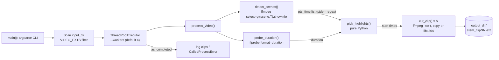

# Clipper

## Summary
Clipper is a single-file Python command-line tool. It scans a folder of videos, uses FFmpeg's scene-change score to find the "busiest" stretches of each one, and cuts a fixed-length highlight clip around each stretch (`README.md:3`, `clipper.py:2`). It is meant to be run by hand or from a script on a local folder: `python clipper.py videos/ clips/` (`README.md:6`). The project is very small: 2 files (`clipper.py`, 92 lines; `README.md`, 10 lines), 5 functions plus `main`, no third-party dependencies, no tests, and no git history, so its size over time and its authorship can't be checked. It reads like a one-person script, but with no history the candidate's role is unknown. None of the production pieces the CV implies (a scheduler, queue, cloud storage, hardware encoding or metrics) are in this code.

## Stack
| Technology | Used for | Evidence |
|---|---|---|
| Python 3.9+ | Whole tool. The built-in generic hints `list[float]` are evaluated when each function is defined, so it needs 3.9 or later | `clipper.py:24`, `clipper.py:35` |
| ffprobe | Reading the container duration as JSON | `clipper.py:17-21` |
| FFmpeg `select` + `showinfo` filters | Scene-change detection | `clipper.py:26-29` |
| FFmpeg stream copy (`-c copy`) | Default, fast, keyframe-aligned cutting | `clipper.py:53` |
| libx264 (CRF 23, `veryfast`) + AAC 128k | Optional frame-accurate re-encode (`--reencode`), all in software | `clipper.py:51`, `clipper.py:75` |
| `subprocess` | Running ffmpeg/ffprobe with argv lists (no shell) | `clipper.py:17`, `clipper.py:26`, `clipper.py:55` |
| `concurrent.futures.ThreadPoolExecutor` | Processing several videos in parallel | `clipper.py:8`, `clipper.py:81-88` |
| `argparse` | CLI with 2 positional arguments and 5 options | `clipper.py:68-76` |
| `re` | Pulling `pts_time` out of ffmpeg's stderr | `clipper.py:13`, `clipper.py:32` |
| `logging` | One line of output per video | `clipper.py:11`, `clipper.py:77`, `clipper.py:86-88` |

Not present, though the CV lists them elsewhere: FastAPI, Django, SQLAlchemy, PostgreSQL, Redis, Celery, Docker, AWS S3/EC2, pytest. The repo has no `requirements.txt`, `pyproject.toml`, `Dockerfile` or CI config.

## Architecture

There is one entry point, `main()` (`clipper.py:67`, called from `clipper.py:91-92`). It parses the arguments, creates the output folder, lists the video files in the input folder (not recursively), and sends one `process_video` job per file to a thread pool (`clipper.py:79-82`). Each job runs entirely in external processes: one `ffprobe`, one full decode by `ffmpeg` for scene detection, then up to `--max-clips` cutting runs, one after another. The only logic in Python is the grouping and ranking in `pick_highlights` (`clipper.py:35-45`). The only data store is the local filesystem. The only external dependency is the `ffmpeg`/`ffprobe` binaries on PATH (`README.md:10`).

## Components
### CLI and batch driver
- **What:** Parses options, finds the input videos, runs them through a thread pool and logs the result of each one.
- **How:** `argparse` defaults are threshold 0.4, clip length 15 s, max clips 5, workers 4, re-encode off. Inputs are files in `input_dir` whose lower-cased suffix is in `{.mp4,.mov,.mkv,.webm}`. A dict maps each future to its video, and results are logged in the order they finish.
- **Files:** `clipper.py:67-88`, `clipper.py:12`
- **Notable:** Only `subprocess.CalledProcessError` is caught (`clipper.py:87`). Any other exception raised by `fut.result()` breaks out of the loop. The process always exits 0 if nothing is raised, even when some videos failed. There's no `is_file()` check, and subfolders aren't scanned.

### Duration probe
- **What:** Gets the container duration in seconds.
- **How:** Runs `ffprobe -show_entries format=duration -of json` with `check=True`, then `float(json["format"]["duration"])`.
- **Files:** `clipper.py:16-21`
- **Notable:** It uses the container (format) duration, not the stream duration. If the duration is missing or `"N/A"` (possible with some WebM/streamed files), `float()` raises `ValueError`, which `main` doesn't catch.

### Scene detector
- **What:** Returns the timestamps where FFmpeg's scene-change score is above the threshold.
- **How:** Runs `ffmpeg -i src -vf "select='gt(scene,T)',showinfo" -an -f null -`. `select` drops every frame whose score is at or below T. `showinfo` prints one stderr line for each frame that survives. `PTS_RE` then pulls out the `pts_time:` values.
- **Files:** `clipper.py:24-32`, `clipper.py:13`
- **Notable:** It doesn't pass `check=True`, so a failed decode returns `[]` without any error. It also deliberately doesn't set `-loglevel error` (unlike `cut_clip`), because `showinfo` writes at info level and would be silenced. It decodes every frame at full resolution with no hardware acceleration, which makes this the most expensive step in the pipeline.

### Highlight picker
- **What:** Turns the scene timestamps into at most `max_clips` clip start times.
- **How:** Groups timestamps greedily: a timestamp joins the current group if it falls within `clip_length` of the group's *first* timestamp. Groups are ranked by size, the top N are kept, each start is moved back by a fixed 1.0 s of lead-in (clamped at 0), the starts are put back in time order, and any clip that would run past `duration` is dropped.
- **Files:** `clipper.py:35-45`
- **Notable:** It's the only pure function, so it's easy to unit-test, but there are no tests. Because Python's sort is stable, ties go to the earlier group. Clips are numbered in time order, not by score.

### Clip cutter
- **What:** Cuts one clip.
- **How:** `ffmpeg -y -ss START -i src -t LEN` (seek on the input side), followed by either `-c copy -avoid_negative_ts make_zero` or `-c:v libx264 -crf 23 -preset veryfast -c:a aac -b:a 128k`. Runs with `check=True`.
- **Files:** `clipper.py:48-55`
- **Notable:** With stream copy, the clip actually starts at the keyframe before `START`, so the 1 s lead-in means little when keyframes are far apart. With re-encoding, ffmpeg decodes from that keyframe and throws frames away until `START`, which makes the cut frame-accurate (as the `--reencode` help says, `clipper.py:75`).

### Per-video pipeline
- **What:** Ties probe, detect, pick and cut together for one file.
- **How:** Cuts the clips one after another and names them `{stem}_clip{NN}{original suffix}`.
- **Files:** `clipper.py:58-64`
- **Notable:** It takes the whole argparse `Namespace`, which ties the core logic to the CLI. Because the output keeps the source suffix, `--reencode` on `.webm` files will fail (see Weak spots).

## Key flows
**1. Batch run: `python clipper.py videos/ clips/ --workers 4`**
1. Parse the arguments and set up logging (`clipper.py:68-77`).
2. Create `output_dir` (`clipper.py:79`).
3. List `input_dir`, keep files with known video extensions (case-insensitive) and sort them (`clipper.py:80`).
4. Submit `process_video(v, output_dir, args)` for each video to a pool of `--workers` threads (`clipper.py:81-82`).
5. As each job finishes, log `"<name>: N clips"`, or log the error if it raised `CalledProcessError` (`clipper.py:83-88`).
6. When the `with` block exits, it waits for every job (`clipper.py:81`).

**2. One video: `process_video`**
1. `probe_duration`: ffprobe returns the duration as JSON (`clipper.py:59`, `clipper.py:16-21`).
2. `detect_scenes`: full decode with `select`+`showinfo`, then the regex collects `pts_time` values from stderr (`clipper.py:60`, `clipper.py:26-32`).
3. `pick_highlights`: group the timestamps, rank by count, take the top `max_clips`, move each back 1 s, drop any that overrun the video (`clipper.py:61`, `clipper.py:37-45`).
4. Call `cut_clip` for each start time, one after another (`clipper.py:62-63`).
5. Return the clip count to the pool (`clipper.py:64`).

**3. One cut: `cut_clip`**
1. Build the base command with input-side seeking: `-ss` goes before `-i` (`clipper.py:49`).
2. Choose re-encode (libx264/AAC) or stream copy with `-avoid_negative_ts make_zero` (`clipper.py:50-53`).
3. Append the output path and run with `check=True`. A non-zero exit becomes `CalledProcessError` and travels up to `main` (`clipper.py:54-55`, `clipper.py:87`).

## Decisions and trade-offs
| Decision | Evidence | Likely reason | Alternatives | Trade-off |
|---|---|---|---|---|
| Run the ffmpeg CLI through `subprocess` | `clipper.py:17`, `26`, `55` | No dependencies; the same commands can be tried by hand | PyAV, ffmpeg-python, PySceneDetect | Simple, but results come from parsing stderr text, errors are coarse, and every step starts a new process |
| Pass argv lists, no `shell=True` | `clipper.py:18`, `27-28`, `49-54` | Safe with filenames that contain spaces or quotes | Shell strings | Correct choice; the filter string still needs ffmpeg's own quoting |
| Scene detection via `select`+`showinfo` stderr | `clipper.py:28`, `31-32` | One ffmpeg command, no extra libraries | `scdet` filter, `metadata=print:file=`, PySceneDetect | Depends on the format of ffmpeg's log lines; needs a full decode |
| "Highlight" = most scene cuts in a window | `clipper.py:36-43` | Cheap stand-in for "eventful" | Audio loudness (`ebur128`/`astats`), motion vectors, ML models | Fails on static-camera footage; easily fooled by fades and flicker |
| Stream copy by default, re-encode only on request | `clipper.py:50-53`, `75` | Copying is close to instant, with no quality loss | Always re-encode; smart-cut (re-encode only the first GOP) | Copy cuts start on keyframes, so clips can begin seconds early |
| Seek on the input side (`-ss` before `-i`) | `clipper.py:49` | Fast seeking, no decoding from the start of the file | Output-side `-ss` (accurate but slow) | Fast; accuracy then depends on copy vs re-encode |
| Threads, not processes | `clipper.py:81` | Workers only wait on child processes, and the GIL is released while they wait | `ProcessPoolExecutor`, asyncio subprocesses, a job queue | Fine for I/O waiting, but `workers` × ffmpeg's own threads can oversubscribe the CPU |
| Keep the source container for outputs | `clipper.py:63` | No remuxing needed with stream copy | Always write `.mp4` | Breaks `--reencode` for `.webm` (H.264/AAC are not allowed in WebM) |
| libx264 CRF 23, `veryfast` | `clipper.py:51` | Standard quality/speed defaults | NVENC/QSV/VideoToolbox, `ultrafast`, a different CRF | Software encoding; no hardware acceleration at all |
| Fixed 1.0 s lead-in, fixed clip length | `clipper.py:44`, `72` | Simple | Lead-in as a flag, variable-length clips | Lead-in isn't configurable; groups near the end are dropped rather than moved earlier |

## Non-obvious details
- The single quotes in `select='gt(scene,{threshold})'` (`clipper.py:28`) reach ffmpeg unchanged, because there's no shell. FFmpeg's filtergraph parser uses them to protect the comma inside `gt(scene,0.4)`. Without the quotes, that comma would be read as a separator between filters.
- `detect_scenes` leaves out `-loglevel error` on purpose (compare `clipper.py:27` with `clipper.py:49`). `showinfo` writes at info level, so adding it would leave the regex nothing to match and every video would yield 0 clips with no error.
- `-an -f null -` (`clipper.py:28`) skips audio decoding and throws the output away, so only the video decode costs anything.
- Groups are tied to the group's *first* timestamp, not a sliding window (`clipper.py:39`), so each group covers less than `clip_length`. The clip starts 1 s before the group (`clipper.py:44`), so scene changes in the last second of the group's window fall outside the clip.
- Consecutive group starts are at least `clip_length` apart, so clips don't overlap. The exception is the `max(0.0, …)` clamp (`clipper.py:44`): if the first group starts in the first second, it can overlap the next clip by under 1 s.
- `sorted(..., reverse=True)` is stable (`clipper.py:43`), so when two groups tie on count, the earlier one wins. Starts are then put back in time order (`clipper.py:44`), so `clip01` is the earliest clip, not the best.
- `PTS_RE` (`clipper.py:13`) only matches non-negative times, so a negative `pts_time` would be skipped without notice. This is an edge case.
- `f"{start:.2f}"` (`clipper.py:49`) rounds seek points to 10 ms.
- `-avoid_negative_ts make_zero` is only on the copy path (`clipper.py:53`). It shifts the timestamps of the keyframe-aligned lead-in so the clip starts at 0.
- `f.suffix.lower()` (`clipper.py:80`) accepts `.MP4`/`.MOV` from cameras and phones.
- Running it again overwrites earlier output because of `-y` (`clipper.py:49`). Nothing is skipped and nothing is cached.

## Weak spots
- **No tests, no packaging, no CI, no Dockerfile.** There's nothing beyond `clipper.py` and `README.md`, and no pinned ffmpeg version. `pick_highlights` is pure and could easily be tested, but isn't.
- **Silent failure in detection:** `detect_scenes` has no `check=True` (`clipper.py:26-30`). A corrupt or unsupported file gets logged as `"x: 0 clips"`, not as an error.
- **Narrow exception handling:** only `CalledProcessError` is caught (`clipper.py:87`). Any of these escapes from `fut.result()`, stops the result loop and ends the program with a traceback:
  - `ValueError` from a duration of `"N/A"` (`clipper.py:21`);
  - `FileNotFoundError` when ffmpeg is missing;
  - likely, `UnicodeDecodeError` from `text=True` when stderr contains non-UTF-8 metadata (`clipper.py:19`, `29`).

  The executor's shutdown still waits for the other jobs, but their results are never logged.
- **No timeouts** on any `subprocess.run` call (`clipper.py:17`, `26`, `55`). A hung ffmpeg blocks its worker forever.
- **Exit code is always 0** when failures are caught (`clipper.py:87-88`). A cron job or orchestrator can't tell that the run went wrong.
- **`--reencode` fails on `.webm`**: the output keeps the `.webm` suffix (`clipper.py:63`) but gets libx264/AAC (`clipper.py:51`), which WebM doesn't allow.
- **Stream-copy cuts are keyframe-aligned** (`clipper.py:53`). Clips can start several seconds early when keyframes are far apart, so the 1 s lead-in doesn't mean much.
- **Cost profile:** a full-resolution software decode of every video just for detection (`clipper.py:27-28`), with no downscaling, frame-rate cap or `-hwaccel`. On top of that, `--workers` × ffmpeg's own automatic thread count oversubscribes the CPU (`clipper.py:81`).
- **Lost highlights:** groups near the end are dropped instead of being moved earlier (`clipper.py:45`). Videos shorter than `clip_length` produce nothing. Static-camera footage produces few or no scene changes, so few or no clips.
- **No hardware acceleration anywhere**, even though the CV says so (`clipper.py:51`).
- **Nothing for "500+ videos a day"**: no scheduler or watcher, queue, retries, S3, database, idempotency/skip-existing, progress tracking or metrics. Failed cuts leave partial files behind.
- **Design:** `process_video` takes the argparse `Namespace` (`clipper.py:58`). Clips for one video are cut one after another, so one long video holds up a worker.
- No secrets found.

## Probe points
- `[what] Walk me through what happens to one video, from being found in the folder to clips on disk.` · topic: `ffmpeg-clipper/pipeline` · answer in: `clipper.py:58` · key idea: ffprobe duration, then one full decode for scene detection, then grouping in Python, then up to max_clips ffmpeg cuts run one after another.
- `[how] How do you get scene-change timestamps out of ffmpeg?` · topic: `ffmpeg-clipper/scene-detection` · answer in: `clipper.py:26` · key idea: select='gt(scene,T)' keeps frames above the threshold, showinfo logs them to stderr, and a regex pulls out pts_time. The quotes protect the comma, and there's no -loglevel because showinfo logs at info.
- `[how] How does pick_highlights decide which moments win?` · topic: `ffmpeg-clipper/highlight-selection` · answer in: `clipper.py:35` · key idea: greedy windows tied to each group's first cut, ranked by number of cuts, top N kept, 1 s lead-in, put back in time order, dropped if they run past the end.
- `[why] Why is stream copy the default, and what exactly does --reencode buy you?` · topic: `ffmpeg-clipper/seeking-and-stream-copy` · answer in: `clipper.py:48` · key idea: copying costs almost nothing but starts on the previous keyframe; re-encoding decodes up to the seek point, so the cut is frame-accurate, at the cost of running libx264.
- `[why] Why shell out to the ffmpeg CLI instead of using PyAV or ffmpeg-python?` · topic: `ffmpeg-clipper/ffmpeg-integration` · answer in: `clipper.py:17` · key idea: no dependencies and commands you can reproduce by hand; the cost is parsing stderr text and starting a process per step; argv lists avoid shell-quoting bugs.
- `[why] Why a ThreadPoolExecutor rather than processes or asyncio, and how did you choose 4 workers?` · topic: `ffmpeg-clipper/concurrency` · answer in: `clipper.py:81` · key idea: the threads only wait on child processes, so the GIL doesn't matter; but each ffmpeg is multi-threaded itself, so workers × ffmpeg threads oversubscribes the cores.
- `[what-if] A file is corrupt and the detection ffmpeg exits non-zero. What does the user see?` · topic: `ffmpeg-clipper/error-handling` · answer in: `clipper.py:26` · key idea: there's no check=True, so it returns [] and the video is logged as "0 clips", not as a failure.
- `[what-if] What happens if you run --reencode on a folder of .webm files?` · topic: `ffmpeg-clipper/containers-and-codecs` · answer in: `clipper.py:63` · key idea: the output keeps the .webm suffix but gets H.264/AAC, which WebM doesn't allow, so every cut fails.
- `[what-if] The best action is in the last 10 seconds, or the video is shorter than --clip-length. What do you get?` · topic: `ffmpeg-clipper/highlight-selection` · answer in: `clipper.py:45` · key idea: those starts are filtered out instead of being clamped to duration minus clip_length, so you get fewer clips or none.
- `[what-if] ffprobe reports the duration as N/A, or ffmpeg isn't on PATH. What happens to the rest of the batch?` · topic: `ffmpeg-clipper/error-handling` · answer in: `clipper.py:87` · key idea: only CalledProcessError is caught; a ValueError or FileNotFoundError re-raised from fut.result() breaks the logging loop, the remaining jobs finish without being logged, and the run crashes.
- `[change] How would you test this without real footage?` · topic: `ffmpeg-clipper/testing` · answer in: `clipper.py:35` · key idea: table-driven unit tests for the pure pick_highlights; synthetic videos made with lavfi (testsrc/color with hard cuts) for integration tests; mock subprocess to test the error paths.
- `[why] Your CV says hardware-accelerated encoding cut processing time by 3x. Show me where, and where would hardware actually help this pipeline?` · topic: `ffmpeg-clipper/hardware-acceleration` · answer in: `clipper.py:51` · key idea: there's only software libx264 behind an opt-in flag, and the default path doesn't encode at all; the main cost is the full-resolution decode in detect_scenes, so hardware decoding or downscaling would be where the speed comes from.
- `[change] How would you make scene detection 3-5x faster without changing the results much?` · topic: `ffmpeg-clipper/scene-detection` · answer in: `clipper.py:28` · key idea: downscale before select, use -hwaccel for decoding, cap the frame rate, consider the scdet filter, and check speed and accuracy against a fixed set of test videos.
- `[change] Is "most scene cuts in 15 s" a good definition of a highlight? What breaks it, and what would you add?` · topic: `ffmpeg-clipper/highlight-selection` · answer in: `clipper.py:43` · key idea: static-camera sport or gameplay scores near zero and fades or flashes fool it; add audio loudness (ebur128/astats), motion, or a learned scorer, and tune the threshold per source.
- `[change] Turn this into something that reliably processes 500+ videos a day. What would you build?` · topic: `ffmpeg-clipper/scaling-to-production` · answer in: `clipper.py:80` · key idea: about 173 s per video on a single serial worker; a job queue (Celery/Redis), S3 in and out, idempotent output keys, timeouts and retries, non-zero exit codes and metrics, a container with a pinned ffmpeg version, and tests.

## CV claims vs code
| CV bullet | Evidence | What the code shows |
|---|---|---|
| "Built an automated highlight-clip generator with FFmpeg and Python" | in code | Python CLI that drives ffprobe/ffmpeg to detect scenes and cut clips (`clipper.py:58-64`, `clipper.py:67-88`). "Automated" only goes as far as batch-processing one folder per run: there's no scheduler, watcher or service. |
| "processing 500+ videos a day" | none (needs the user's own account) | No deployment, scheduling, throughput logging, benchmark or storage integration. It's a one-off local run over `input_dir` (`clipper.py:80`). |
| "Used scene detection to pick highlights" | in code | `select='gt(scene,T)',showinfo` detection (`clipper.py:24-32`) feeds a ranking of cut-dense windows (`clipper.py:35-45`). |
| "hardware-accelerated encoding" | none | The only encoder is software `libx264` (`clipper.py:51`), and only with `--reencode`. There's no `-hwaccel`, `h264_nvenc`, `h264_qsv`, `h264_vaapi` or `h264_videotoolbox`. By default nothing is encoded at all (`-c copy`, `clipper.py:53`). |
| "to cut processing time by 3x" | none (needs the user's own account) | No benchmark, timing code or test. The speed-ups the code does show are stream copy instead of re-encoding (`clipper.py:53`), `-preset veryfast` (`clipper.py:51`) and parallel workers (`clipper.py:81`). Any of these could be the real source of a "3x". |

Both bullets are only partly supported: 3 of the 5 sub-claims have no evidence in the code.

## Numbers
- Files: 2 (`clipper.py`, 92 lines; `README.md`, 10 lines). Commits: not a git repo. Tests: 0. Third-party Python dependencies: 0.
- Functions: 5 plus `main` (`clipper.py:16`, `24`, `35`, `48`, `58`, `67`).
- CLI: 2 positional arguments and 5 options (`clipper.py:69-75`).
- Defaults: `--threshold 0.4` (`clipper.py:71`), `--clip-length 15.0` s (`clipper.py:72`), `--max-clips 5` (`clipper.py:73`), `--workers 4` (`clipper.py:74`), re-encode off (`clipper.py:75`).
- Supported extensions: 4: `.mp4 .mov .mkv .webm` (`clipper.py:12`).
- Re-encode settings: libx264 CRF 23, preset `veryfast`, AAC 128 kb/s (`clipper.py:51`).
- Lead-in before each highlight: 1.0 s, hard-coded (`clipper.py:44`). Seek precision: 2 decimal places (`clipper.py:49`).
- External processes per video: 1 ffprobe + 1 detection decode + up to `max_clips` cuts, so up to 7 at the defaults (`clipper.py:59-63`).
- Maximum output per video at the defaults: 5 × 15 s = 75 s.
- Subprocess timeouts: none. Retries: none.
- Calculated: 500 videos/day = one every ~173 s (86,400 / 500). With 4 workers that allows ~11.5 min per video, so the CV figure is plausible for short clips on one machine, but the code can't prove it.
